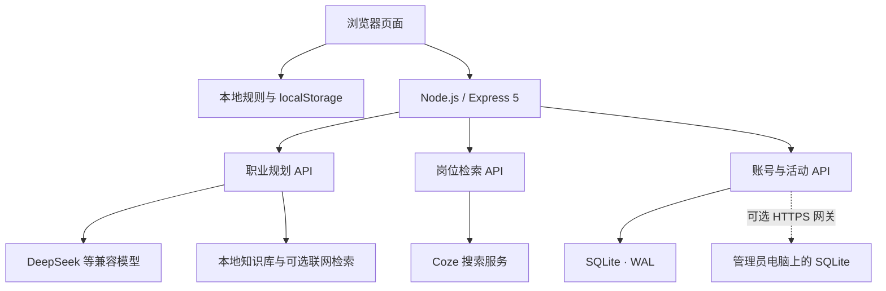

# 职途星轨 · University Career Explorer

**面向大学生的 AI 职业发展平台**

> 我还没定目标岗位，大学这几年可以先做什么？等拿到一份招聘简章，又该怎样改简历、讲清自己的项目？

职途星轨以个人经历为起点，通过 AI 对话、能力梳理和岗位分析，帮助大学生探索职业选择，把模糊的目标转化为可以尝试的下一步行动。

项目围绕大学不同阶段的需求，将**成长路线、方向探索、能力画像、岗位匹配与求职练习**连接起来。大一、大二可以先尝试方向、积累经历；进入实习和校招阶段后，可以围绕具体岗位核对能力、改进简历，并练习如何在面试中讲清自己的贡献。随着新经历和反馈积累，学生可以回到职业规划 AI，继续调整自己的路线。

[在线体验](https://university-career-explorer.onrender.com/index.html) · [打开职业规划 AI](https://university-career-explorer.onrender.com/index.html#intelligence) · [GitHub 仓库](https://github.com/Adastra867/university-career-explorer) · [问题反馈](https://github.com/Adastra867/university-career-explorer/issues)

## 导航

- [为什么做职途星轨](#为什么做职途星轨)
- [适合谁使用](#适合谁使用)
- [核心功能](#核心功能)
- [技术架构与数据流](#技术架构与数据流)
- [改版实践与验证](#改版实践与验证)
- [本地运行](#本地运行)
- [模型与搜索配置](#模型与搜索配置)
- [资料保存与管理后台](#资料保存与管理后台)
- [部署到 Render](#部署到-render)
- [项目结构与开发](#项目结构与开发)
- [后续迭代方向](#后续迭代方向)
- [团队与协作](#团队与协作)
- [许可信息](#许可信息)

## 为什么做职途星轨

职业规划经常从一个具体的困惑开始。学生可能想弄清专业对应哪些岗位、哪条路线值得先尝试，或者怎么把做过的项目和招聘要求联系起来。

学生可以从一个问题开始，**了解有哪些选择，尝试一件具体的事，再根据真实经历调整方向。**

- **用对话降低开始的门槛。** 可以先说出困惑，再逐步补充信息。职业规划 AI 支持参考用户授权的已有资料，减少反复描述背景的负担。
- **为多种未来保留空间。** 通过方向排序、路线比较和职业树画布，探索不同选择，并随着实践重新调整优先级。
- **用经历支撑判断。** 将课程、科研、实习和项目中的具体行动与岗位要求联系起来，让能力分析有可以核对的材料依据。
- **让规划落到行动。** 把方向探索与项目积累、岗位分析、简历表达和面试练习连接起来，帮助学生明确下一步可以做什么。

“职途”对应学生逐步探索的职业方向，“星轨”表达多条可能的发展路线。项目希望支持学生在持续尝试中形成自己的选择，并将职业发展记录积累为可以回看和调整的过程。

## 适合谁使用

| 阶段 | 常见问题 | 推荐使用方式 |
| --- | --- | --- |
| 大一 | 我的专业有哪些可能？现在可以先尝试什么？ | 与职业规划 AI 讨论成长路线，浏览方向卡，安排小规模的入门体验 |
| 大二 | 我对几条路线都感兴趣，应该优先验证哪条？ | 梳理能力画像，排列意向方向，用职业树整理备选路线 |
| 大三 | 想申请实习或继续深造，需要积累什么经历？ | 比较路线、整理项目证据，结合目标岗位要求制定准备计划 |
| 大四及求职阶段 | 我的经历与岗位要求差在哪里？面试时怎样讲清贡献？ | 分析 JD，改进简历表达，完成笔试和模拟面试练习 |

学生可以从当前最需要的模块开始。职业规划 AI 无需等待全部测评完成后才能使用。

## 核心功能

### 1. 成长路线｜职业规划 AI 从一个问题开始

采用对话式入口，将“制定成长路线”“比较职业方向”等任务作为引导问题。用户可以用自然语言描述困惑，获得分阶段建议，并继续追问或补充背景。

- 讨论大学阶段的成长安排、职业选择和下一步行动。
- 在用户授权后，参考已保存的个人资料与经历。
- 根据用户选定的历史记录或文件内容补充讨论上下文，支持含可提取文字的 PDF，以及 TXT、MD、CSV 资料。
- 将有用的建议保存到“我的规划记录”，方便后续回看。

试着输入一个具体的困惑。

> 我是大二学生，对数据分析和产品方向都有兴趣。请先帮我设计两周内能完成的探索行动。

> 根据我提供的项目经历，比较这几个方向，并说明各自还需要验证什么。

[进入职业规划 AI](https://university-career-explorer.onrender.com/index.html#intelligence)

### 2. 方向探索与能力画像｜整理选择依据

方向探索根据学历、专业和就业倾向提供方向卡，帮助学生了解可能的入门岗位与能力要求。学生可以选择 3–5 个备选方向，按希望优先验证的顺序排列。

- **软实力测评**通过 25 项自评与 6 道情境题观察偏好和行动方式，生成供自我反思的结果与能力雷达。
- **硬实力解析**从课程、科研、实习或项目原文中识别技能线索，例如 Python、SQL、Excel，学生可以回到材料核对具体做过的事。

这些结果用于帮助学生提出后续探索的问题。方向排序可以在实践后调整，技能标签也需要结合本人做过的具体工作理解。

[方向探索](https://university-career-explorer.onrender.com/index.html#direction) · [能力画像](https://university-career-explorer.onrender.com/index.html#ability)

### 3. 岗位推荐与 JD 分析｜把经历与要求对照起来

“推荐岗位”结合教育背景、意向排序、软实力线索和经历中体现的技能，给出可以进一步检索的岗位方向。独立的岗位搜索页提供关键词检索入口。

拿到具体招聘描述（Job Description，JD）后，可以粘贴到“分析 JD”，查看材料已经体现哪些要求、哪些部分还缺少证据，再决定是补充已有经历，还是安排新的学习与实践。

**JD 覆盖率衡量当前材料里识别到的岗位要求。** 没有被识别出的要求，也可能是材料尚未写清楚。学历等门槛单独核对。

实时招聘信息取决于部署端的搜索服务配置与实际返回结果。未连接实时招聘源时，岗位方向建议仍可作为进一步检索的起点。

[推荐岗位](https://university-career-explorer.onrender.com/index.html#jobs) · [分析 JD](https://university-career-explorer.onrender.com/index.html#jobs/manual) · [岗位搜索](https://university-career-explorer.onrender.com/job-search.html)

### 4. 面试帮助｜围绕同一岗位反复练习

确定目标岗位后，可以在“求职冲刺”中进行简历诊断、笔试练习和模拟面试。

- 用**简历指导**检查经历与目标岗位的联系，补充个人行动、成果和交付物。
- 完成 **3 道岗位笔试题**，再对照参考要点复盘。
- 进行 **4 轮模拟面试**，根据回答接受追问，并在同一轮重新作答。
- 下载**练习记录**，把表达不清或证据不足的部分整理成后续练习目标。

例如，可以把「我参与了一个校园数据项目」补充为具体负责哪部分数据、用了什么方法、最后交付了什么。练习后，可以把发现的问题带回职业规划 AI，讨论下一步如何改进。

当前版本的求职练习由浏览器本地题库与规则生成问题、追问和反馈。

[进入求职冲刺](https://university-career-explorer.onrender.com/career-prep.html)

### 5. 职业树｜把不同路线放到画布上

通过节点和连线整理职业发展的不同可能，逐步扩展方向、比较路线，并继续探索后续步骤。用户可以手动整理自己的规划；与 AI 相关的建议功能需要对应模型配置。

职业树适合整理“当前背景如何走向不同选择”，也可以作为与职业规划 AI 讨论时的参考。

[打开职业树](https://university-career-explorer.onrender.com/trees)

### 6. 统一资料与活动管理｜保存草稿和确认提交

“统一资料”提供学生注册、登录、资料保存和任务草稿入口。在资料服务配置完成后，学生可以通过账号恢复统一资料，并按需授权职业规划 AI 参考。

活动组织者可以创建活动、分享参与链接或二维码，并在管理后台查看学生明确提交的资料快照。学生保存草稿与向活动提交资料是不同的操作。

[统一资料入口](https://university-career-explorer.onrender.com/start)

## 技术架构与数据流

Express 5 在同一个 Node.js 服务里提供静态页面和 API。前端使用原生 HTML、JavaScript、Tailwind CSS 3，并用 Chart.js 绘制图表。能力测评、JD 覆盖率和求职练习可以在浏览器中执行。职业规划、联网检索和服务端资料保存分别通过 API 请求对应的服务。



- **职业规划。** [`journey/career-intelligence-server.js`](journey/career-intelligence-server.js) 为画像分析、方向探索、阶段计划、路线比较和成长建议组织上下文，使用 [`journey/ai-provider.js`](journey/ai-provider.js) 调用配置的模型，并校验结构化结果和来源引用。用户授权的画像、历史记录和文件内容用于模型上下文。公开检索使用单独的搜索词。
- **岗位证据。** [`scripts/job-scoring.js`](scripts/job-scoring.js) 为前后端提供统一的材料匹配规则。页面区分可检索的岗位方向、带来源的公开结果和用户材料的覆盖率。实时结果可回到招聘方原文核实。
- **数据归属。** [`p0/api.js`](p0/api.js) 按当前会话和数据归属处理访问，相关写入检查 CSRF 与请求来源。服务端用加盐 scrypt 保存密码哈希，SQLite 保存会话令牌的哈希。任务草稿经用户确认后形成提交快照。同一请求标识的重试可恢复已保存的结果。学生可以撤回提交、删除本人服务端资料。

## 改版实践与验证

### 让学生先拿到一条能试的路线

答辩用同一句「帮我制定未来三年的成长路线」比较了两版体验。旧版先追问目标岗位，学生还没想好时，第一轮没有拿到路线。改版后，即使画像为空，模型也可以说明当前假设，先给出探索方向、完成项目、整理作品的分阶段建议，再由学生补充信息。实测示例的第一步是从几个方向里挑两个，各做一次不超过 4 小时的入门体验。

首页与导航也改成按任务进入。学生可以通过首页的任务入口打开对话，或直接前往方向、能力、岗位和求职练习。 [首页与工作台改版提交](https://github.com/Adastra867/university-career-explorer/commit/131227c)

### 保留输入并说明异常

| 场景 | 页面或接口行为 |
| --- | --- |
| 职业规划模型未配置 | 服务端返回 `503 AI_NOT_CONFIGURED`，页面提示原因并保留输入 |
| 模型超时或限流 | 提示暂时失败，保留输入以便重试 |
| 规划结果可修复但未通过校验 | 服务端最多发起一次纠错请求，校验仍失败时提示用户 |
| 统一资料页的轻量建议无法调用模型 | 显示带规则标识的建议 |
| 实时推荐缺少可核验的岗位结果 | 返回搜索方案，提供可继续核实的岗位类型和搜索入口 |

### 验证程序行为和回答质量

- **自动化与浏览器回归**覆盖职业规划 API、资料授权与脱敏、SQLite 和提交快照、账号访问隔离，以及模型异常和存储缺失时的行为。本次在已提交代码上复核了 47 个应用模块的语法和 358 个自动化用例，均通过。 [常用开发命令](#常用开发命令)
- **真实模型验收**用合成场景调用 DeepSeek，包含空画像和只输入一句话的情况，检查首答能否给出具体行动。答辩的 8 个场景都拿到了可执行的第一步。这是当次场景的验收结果。

## 本地运行

### 环境要求

- **Node.js 24 或更高版本**，用于运行服务和内置 SQLite。
- **pnpm**，用于按锁文件安装依赖。
- **Git**，用于获取项目代码。

### 获取代码与启动

```bash
git clone https://github.com/Adastra867/university-career-explorer.git
cd university-career-explorer
pnpm install --frozen-lockfile
```

首次运行可将根目录的 [`.env.example`](.env.example) 复制为 `.env`。在 macOS 或 Linux 上运行以下命令。

```bash
test -e .env || cp .env.example .env
```

Windows PowerShell 使用下面的命令。

```powershell
if (!(Test-Path .env)) { Copy-Item .env.example .env }
```

默认配置即可启动本地页面与资料服务。在线模型、实时搜索及管理员账号按下面的说明单独配置。

```bash
pnpm start
```

打开 [http://localhost:5000/](http://localhost:5000/)。统一资料入口为 `/start`，管理后台入口为 `/admin`。

默认数据库为 `data/career.sqlite`，服务启动时自动执行 `p0/migrations/` 下的迁移。以下是本地端口、数据库路径和公开地址的配置示例。

```dotenv
PORT=5000
NODE_ENV=development
CAREER_DB_PATH=./data/career.sqlite
CAREER_PUBLIC_URL=http://localhost:5000
```

## 模型与搜索配置

### 职业规划 AI

将配置写入**根目录 `.env`**。使用 DeepSeek 时，把示例中的密钥和模型 ID 换成账号实际可用的值。

```dotenv
JOURNEY_AI_PROVIDER=deepseek
JOURNEY_AI_BASE_URL=https://api.deepseek.com
JOURNEY_AI_API_KEY=replace_with_your_api_key
JOURNEY_AI_MODEL=replace_with_an_available_model_id
JOURNEY_AI_ENABLED=true
```

修改配置后重启服务。完整变量、兼容别名与可选设置见 [Journey 环境变量示例](journey/.env.example)。`pnpm start` 读取根目录 `.env`；部署环境中已有的环境变量优先。

API Key 只配置在服务端。部署到 Render 时，使用控制台环境变量填写真实凭据。

### 轻量建议与实时搜索

| 配置 | 用途 |
| --- | --- |
| `CAREER_AI_PROVIDER`、`CAREER_AI_BASE_URL`、`CAREER_AI_API_KEY`、`CAREER_AI_MODEL` | 单独配置统一资料页的轻量建议；未设置时可复用 `JOURNEY_AI_*` 或 `DEEPSEEK_*` |
| `COZE_API_TOKEN` | 项目现有 Coze 搜索链路的凭据之一；实际联网能力以部署配置和验证结果为准 |
| `JOURNEY_AI_TIMEOUT_MS` | 在线模型调用超时设置 |
| `JOURNEY_CAREER_INTELLIGENCE_MAX_OUTPUT_TOKENS` | 职业规划输出的可选长度预算 |

启动后可在职业规划 AI 页面发起一次对话验证模型输出。`node scripts/verify-career-ai.mjs` 使用合成输入验证统一资料页的在线轻量建议。

## 资料保存与管理后台

### 数据保存范围

| 内容 | 主要保存位置与恢复方式 |
| --- | --- |
| 统一资料、账号和活动提交记录 | 启用资料服务后由服务端 SQLite 保存；账号登录支持恢复统一资料 |
| 问答中的个人资料 | 保留浏览器本地副本；连接统一资料后，相关修改也可保存到服务端 |
| 完整聊天记录、规划记录、职业树与部分练习状态 | 主要保存在当前浏览器，具体范围以对应功能实现为准 |
| 用户主动下载的报告与练习记录 | 由用户保存到自己的设备 |

跨设备恢复目前覆盖统一资料。完整聊天、职业树和部分练习状态跟随当前浏览器。访客通过 HttpOnly Cookie 延续身份，生产会话还会设置 Secure 与 SameSite 属性。

职业规划 AI 使用个人资料需要用户授权；历史记录与文件内容由用户选择加入上下文。调用在线模型时，所选上下文会交由配置的模型服务处理。

### 初始化管理员

在根目录 `.env` 中设置管理员信息。

```dotenv
CAREER_ADMIN_USERNAME=your_admin_name
CAREER_ADMIN_PASSWORD=replace_with_a_strong_password
CAREER_ADMIN_DISPLAY_NAME=活动管理员
CAREER_PUBLIC_URL=http://localhost:5000
```

管理员密码至少 12 位。配置后运行初始化命令。

```bash
pnpm admin:init
```

初始化后访问 [http://localhost:5000/admin](http://localhost:5000/admin)。完成初始化后可以从 `.env` 移除管理员密码；再次运行初始化会更新该账号密码并撤销旧登录。

管理员创建活动后，可分享 `/start?campaign=<slug>` 链接或二维码。学生在预览后明确提交，管理员才能查看相应的提交快照。

权限、保留设置和详细操作说明见 [P0 交付说明](docs/CAREER_P0_DELIVERY.md)。

## 部署到 Render

仓库提供 [render.yaml](render.yaml)，用于部署 Node Web Service。

| 项目 | 配置 |
| --- | --- |
| 代码仓库 | `Adastra867/university-career-explorer` |
| 发布分支 | `main` |
| Build Command | `pnpm install --frozen-lockfile` |
| Start Command | `pnpm start` |
| Health Check Path | `/` |
| Node.js | 24 或更高版本 |

1. 在 Render 连接 GitHub 仓库，使用仓库 Blueprint 或创建对应的 Web Service。
2. 确认构建、启动命令及 Node.js 版本，配置模型与搜索所需的环境变量。
3. 将 `CAREER_PUBLIC_URL` 设置为实际公开地址，按部署说明设置 `CAREER_TRUST_PROXY=true`。端口使用平台提供的 `PORT`。
4. 如需账号、资料保存和活动提交，先配置可持久保存数据的资料服务。
5. 部署后核对对应提交，并检查首页、职业规划 AI 和资料服务的实际状态。

Blueprint 配置了提交触发部署。每次发布在 Render 控制台核对部署状态与 Git 提交 SHA。

### 资料持久化

当前 Blueprint 使用免费实例，服务文件系统为临时存储。项目支持将 SQLite 留在管理员电脑，由 Render 通过带认证的 HTTPS 资料网关访问。也可以按部署说明，将 `CAREER_DB_PATH` 指向已挂载的持久磁盘。

生产环境既未配置资料网关、也未显式设置 `CAREER_DB_PATH` 时，相关资料 API 会返回 `STORAGE_NOT_CONFIGURED`，独立运行的本地规则功能仍可使用。采用管理员电脑作为资料服务器时，资料保存和账号恢复依赖该电脑及 HTTPS 隧道在线。配置、发布检查和回滚方法见下列文档。

- [部署说明](docs/DEPLOYMENT.md)
- [本机资料服务器说明](docs/LOCAL_SERVER.md)

本地 `.env`、SQLite 数据库、资料导出及测试产物不应进入 Git 提交。浏览器中的个人资料也不会随源码推送而发布。

## 项目结构与开发

### 主要文件

| 路径 | 说明 |
| --- | --- |
| `index.html` | 主工作台及职业规划、方向、能力、岗位等入口 |
| `career-prep.html` | 求职冲刺页面 |
| `job-search.html` | 岗位搜索页面 |
| `server.js` | Express 服务入口与接口装配 |
| `journey/` | 职业树、路线探索及相关 AI 能力 |
| `p0/` | 统一资料、活动管理及数据库迁移 |
| `scripts/` | 前端逻辑、管理与部署辅助脚本 |
| `styles/` | 样式源文件与编译后的 Tailwind CSS |
| `tests/` | 单元、集成与浏览器回归测试 |
| `docs/` | 部署、交付与开发说明 |

依赖和脚本定义见 [package.json](package.json)。PDF 文本提取使用 PDF.js，活动二维码使用 `qrcode`。

### 常用开发命令

```bash
# 语法检查
pnpm check

# 自动化测试
pnpm test

# 统一资料与活动管理相关测试
pnpm test:p0
pnpm test:p0:browser

# 职业规划对话的浏览器回归
node tests/career-chat-browser.mjs

# 发布前的工作区与暂存区检查
node scripts/check-deploy.mjs
```

浏览器测试需要可用的 Playwright 与 Chromium / Chrome。仓库依赖未包含 Playwright，运行前应按 [浏览器运行环境脚本](tests/browser-runtime.mjs) 配置环境；该脚本支持 `PLAYWRIGHT_MODULE_PATH` 和 `BROWSER_EXECUTABLE_PATH`。

首页和岗位页使用已编译的 `styles/tailwind.css`。修改 Tailwind 类或主题后运行以下命令。

```bash
pnpm build:styles
```

提交对应源码与生成的 CSS。详细开发约定见 [P0 handoff](docs/CAREER_P0_HANDOFF.md)。

## 后续迭代方向

后续改进聚焦资料复用、建议依据和求职练习。

- [ ] 完善个人资料与经历的提取、复用和纠错，减少跨模块的重复填写。
- [ ] 加强规划、能力证据、岗位分析与求职练习之间的信息衔接，让复盘更容易转化为下一步行动。
- [ ] 改进路线比较和职业树的操作体验，更清楚地呈现不同选择需要补充的经历与条件。
- [ ] 完善实时岗位来源、信息时效提示和可核对的匹配依据。
- [ ] 丰富笔试题与面试反馈，并通过实际使用反馈验证练习的帮助程度。
- [ ] 完善数据恢复、导出及授权管理，明确各类资料的保存和使用范围。

以上为后续改进方向，具体范围与进度以仓库更新为准。

## 团队与协作

团队分工包括产品功能设计与初步框架、代码架构梳理与调试，以及使用问题发现和功能改进。

欢迎通过 [Issues](https://github.com/Adastra867/university-career-explorer/issues) 提交使用反馈或功能建议。反馈问题时，请尽量提供操作步骤、预期结果和实际表现，并去除个人资料及凭据。

开发协作采用分支与 Pull Request。合并到 `main` 后，核对 Render 中对应提交的部署状态。

## 许可信息

当前 [package.json](package.json) 的 `license` 字段标注为 `ISC`，仓库尚未提供独立的 `LICENSE` 文件。完整许可文本有待补充。
