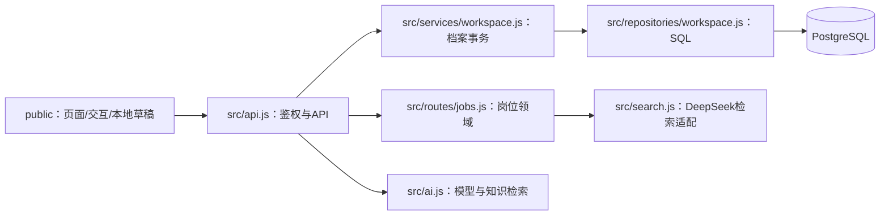

# 工程成熟度、架构与测试审查

审查日期：2026-11-11。主审范围：用户指定的本地 PostgreSQL 版本，分支 feat/postgres-ai-delivery，工作区包括本轮和此前尚未提交的实现。

## 1. 总体结论

项目属于具备真实业务闭环、账号、数据库和AI接口的MVP，适合课程演示及受控小规模试用；尚不宜认定为成熟的长期公开运营产品。功能能跑通、数据库可持久化和已有自动测试，并不等于可维护性、性能、安全运营和发布流程都已成熟。

本轮已修复测试污染开发库、外部CDN依赖、生产依赖已知漏洞、应用导入即监听端口、档案逻辑未分层、报告全量重写、导出快照不一致、部分数据库约束和迁移完整性不足等问题。前端全局耦合、长模型调用持有数据库事务、部分领域未分层等仍是明确债务。

| 维度 | 本轮之后的判断 | 主要依据 |
|---|---|---|
| 功能完整性 | 核心闭环已实现 | 画像、测评、经历、岗位/JD、报告、账号和对话 |
| 前后端边界 | 有JSON API边界，同源部署 | public与src分开，Express同时托管静态资源和API |
| 前端可维护性 | 尚不足 | main.js约2550行，全局状态、内联事件、跨脚本函数覆盖 |
| 后端可维护性 | 开始模块化，尚未完成 | 启动/装配分开；档案三层；账号/聊天仍在API模块直接写SQL |
| 数据一致性 | 小规模场景有可靠基础 | 外键、唯一键、事务、版本冲突、幂等、约束和迁移测试 |
| 性能与扩展 | 缺实际容量证据 | 连接池10个，聊天调用仍持有事务；限流部分为进程内存 |
| 自动化验证 | 已建立可重复本地门禁 | 独立测试库、本地模型替身、离线前端资源、覆盖率与浏览器 |
| 发布与运维 | 尚未闭环 | 当前修改未提交/推送，CI远端未运行；备份调度、告警与回滚仍需线上验收 |

## 2. 前后端到底是否分离

从职责和数据交互看已经分开：浏览器负责交互、展示和本地草稿，后端通过JSON API处理账号、持久化和模型/搜索调用。从部署形态看仍是同仓库、同进程提供静态页面与API的单体，不是两个独立发布的工程。

这对三人课程项目是合理起点。前后端分离不要求分仓、不同端口或微服务。同源部署还简化Cookie鉴权和跨域。需要独立部署时再明确资源基址、API基址、跨域Cookie和Origin策略，不能直接把当前SameSite=Strict会话搬到任意跨站部署中。

本轮的实际边界：

注意：图中的分层仅说明已落地的边界。账号和聊天尚未全部沿service/repository链路拆分，岗位领域的业务逻辑仍主要集中在路由文件，不能以“创建了目录”作为完全分层的证据。

## 3. 前端架构评估

原生JavaScript本身没有问题，当前主要问题是状态与依赖关系。

1. public/js/main.js约2550行，同时包含预置数据、测评、存储、方向规则、岗位匹配、报告与DOM操作，修改一个流程容易影响其他流程。
2. public/js/account.js既处理登录/同步，又直接生成弹窗样式和结构，并通过window.sendChat、window.analyzeExperience、window.matchJD等覆盖原脚本函数。行为依赖加载顺序，存在多份实现与隐藏耦合。
3. 页面大量使用onclick等内联事件。状态变化、DOM更新和持久化没有统一入口，主流程仍依赖全局appData。
4. 前端原有外部Tailwind、图表、PDF和字体资源依赖造成离线/CI不稳定。本轮已替换为本地构建，并升级PDF组件。
5. 浏览器测试覆盖主路径，但部分复杂状态仍通过page.evaluate准备，尚未证明从首页逐项点击完成所有问卷的可用性。

建议先采用明确的ES模块与状态边界：app入口、state、api client、storage adapter，以及profile/assessment/experience/jobs/report/chat各功能模块。用事件监听绑定交互，用显式模块函数替代覆盖window函数。先将业务纯函数移出DOM，再决定是否引入Vue/React与Vite；不建议同时做框架迁移和业务逻辑重写。

建议下一轮优先级：状态与API客户端统一 → 历史/报告拆分 → 聊天/经历/JD控制器拆分 → 完整用户操作端到端用例。前端已有的共享matching.js可以作为纯业务模块起点。

## 4. 后端是否有必要分层

有必要，采用轻量模块化单体即可。目前已经存在账号、档案、报告、对话、模型、知识和招聘搜索多个领域，路由直接混合SQL、外部调用和计分会让事务与测试越来越难控制。

本轮已执行：
- server.js缩至约15行，负责启动和退出；src/app.js负责Express装配，不再因导入应用而监听端口。
- 岗位路由独立到src/routes/jobs.js，保留既有行为。
- 档案路由 → workspace service → workspace repository：服务控制事务边界，repository执行用户作用域参数化SQL。
- 导出使用同一REPEATABLE READ只读事务，批量读取消息，消除原有N+1查询和不同时间点拼接问题。
- 同步改成删除被移除报告、upsert变化报告，未变化报告不再删除重插。

继续需要的分层：auth、conversation、usage/quota分别建立服务；模型和搜索保留provider adapter；校验在边界完成，领域规则放在服务中。无需引入微服务、通用Repository基类、复杂依赖注入框架或消息中间件来装饰目录。

**当前最重要的剩余风险：src/api.js的聊天处理在事务里锁定会话，再await ask调用模型。** 模型延迟会持续占用连接和行锁，足够多的慢请求可能耗尽10个连接。下一轮应使用“短事务登记请求/生成状态 → 事务外调用模型 → 短事务确认版本并保存消息”的方式，配合唯一请求ID、租约/超时、取消与失败恢复。是否引入队列取决于实际并发规模，先解决长事务比先做微服务更重要。

## 5. 数据库设计是否科学、健壮

PostgreSQL选型合理。用户、会话、报告和消息有明确关联，关系型约束有价值；变化较多的模型结果和完整报告快照使用JSONB也是合理设计，无需为聊天再引入NoSQL。

当前优点：
- UUID用户与会话标识；用户归属外键；报告按(user_id,report_id)唯一。
- 消息独立行存储，角色约束，游标分页与会话索引；请求ID与角色组合唯一支持幂等。
- 密码scrypt加盐摘要，数据库只保存会话Token哈希。
- 档案多表写入一个事务，version比较更新避免覆盖其他设备的数据。
- 删除账号/会话级联删除所属数据，全站用量计数不随用户删除而归零。

本轮补强：
- JSONB对象类型、非负版本、报告ID与快照一致、消息/标题长度等CHECK约束。报告ID另外校验JSON字符串类型，防止SQL CHECK将JSON null导致的未知结果误当作通过；已加入回归用例。
- sessions过期时间索引，避免登录时的过期清理只能扫描全表。
- 迁移记录SHA256摘要，已执行文件被改动会拒绝继续；迁移失败整体回滚。
- 健康检查验证所需迁移已应用，不再仅SELECT 1即认为数据库就绪。
- 越界消息游标返回400；相同请求ID用于不同问题返回409。
- 无效AI请求先校验，再占用日额度。

仍需完善：
- assessments目前是每用户一份“当前状态”，历史放在reports；若将来需要多个长期测评任务、不同量表版本，应增加独立assessment_id、量表/报告版本及规范化时间字段。
- profiles和报告重要业务字段大多在JSONB中，当前按用户读快照足够；真正需要按专业、状态或生成时间查询时，再把高频查询字段规范化并建立对应索引，不宜无差别给所有JSON建GIN索引。
- prep和部分扩展数据的应用schema仍较宽，未来应按领域细化，不应只依赖对象类型约束。
- 当前用户隔离主要由应用SQL保证，生产应采用最小权限运行角色、独立迁移角色；可按威胁模型再考虑RLS。
- 需要自动备份、保留策略、恢复时长目标和定期恢复演练。持久卷和“做过一次恢复”不等于持续灾备。
- 对话生成长事务、请求失败的状态恢复，以及多实例限流/缓存仍需完善。

已有CHECK/FK/事务也不能证明任意模型输出正确；原文引文存在不等于推断成立，需单独做语义评估。

## 6. 自动化工作流：已落地

普通CI不使用付费API，不依赖真实学生数据。

1. 固定pnpm版本与锁文件，Node安装顺序先于pnpm11；Node22跑完整门禁，Node24做构建/单元兼容检查。
2. 语法检查（含遗留前端内联脚本）和后端/测试ESLint。
3. 编译Tailwind、使用本地Chart.js和html2pdf.js，前端运行无需CDN。
4. 单元测试，包括测试库命名/同名防护与密钥隔离。
5. PostgreSQL专项与API集成测试：并发、事务回滚、约束、迁移、过期会话、越权、幂等、异常JSON、过大请求、异常压缩体等。
6. 合并子进程覆盖率并执行门槛；范围明确限定后端与共享匹配模块。
7. Playwright测试：实际浏览器、实际Express和PostgreSQL，本地供应商替身；测试中阻止浏览器外网请求。
8. 生产依赖高危漏洞审计门禁，输出和保存验证记录、覆盖率、JUnit、HTML与失败trace等。
9. 真实AI测试另设人工触发工作流，需显式确认费用并配置仓库Secret；不运行于普通PR。

测试库分别为career_integration_test与career_e2e_test，失败也清理本次账号；不会把浏览器测试指向career。命名防护不能代替数据库访问权限隔离，正式CI应使用专用实例/账号。

一条完整验证命令：`pnpm test:coverage`。第一次需安装依赖、启动PostgreSQL并安装Playwright浏览器；见docs/testing.md。

## 7. 本轮实际测试证据

- 单元测试14项通过。
- 数据库5组专项子测试及1组API集成通过（Node报告含父测试共7项）。
- 本地Chrome与Playwright Chromium均完成5项浏览器测试，包括PDF文件下载；GitHub远端运行尚未触发。
- 语法、ESLint、本地构建、锁文件安装和diff空白检查通过。
- 后端+共享匹配模块：行/语句86.88%，分支72.97%，函数96.72%；门槛分别85%、65%、90%。此统计不含2550行遗留前端脚本，不能称作全项目覆盖率。
- 生产依赖审计：初次发现34条已知告警（含11高危、2严重），升级html2pdf.js/Express并锁定修复后的body-parser/qs后，再查为0条。数量来自当日漏洞库，不等于安全证明；本项目使用DOM元素导出而非不可信HTML字符串，具体漏洞可达性也需区分。

供应商替身只验证接口契约、错误处理与证据校验，不证明真实模型语义质量。未执行生产压力测试、正式渗透测试、完整长报告排版验收，也没有在本轮调用付费模型。

## 8. 下一轮建议顺序

| 优先级 | 事项 | 验收依据 |
|---|---|---|
| P1 | 聊天生成移出长事务 | 延迟供应商下仍能访问账号/档案；超时、取消、幂等并发可恢复 |
| P1 | 前端状态与控制器模块化 | 不再覆盖window业务函数；测评/恢复/AI流程回归通过 |
| P1 | 冻结交付版本、提交评审并实际运行远端CI | PR检查可追踪，发布版本能复现，部署SHA与发布标签一致 |
| P2 | 账号恢复、邮箱验证、运维告警与备份调度 | 真实恢复和告警演练记录 |
| P2 | 细化核心字段/版本及接口契约 | 数据迁移与兼容用例；OpenAPI或等价契约文档 |
| P2 | 扩充知识和真实模型评估 | 至少30例人工复核，记录证据、语义与时效问题 |
| P2 | 完整用户操作、可访问性、长PDF与容量测试 | 真实用户任务记录和可复查测试结果 |

## 9. 版本范围与发布限制

本轮fetch发现origin/main已到0df42dc，比当前提交基线多2个提交，新增约100个文件、职业树journey模块、SQLite问卷与管理员功能，属于另一套尚未合并实现。用户已明确本轮以本地PostgreSQL版本为主，所以没有自动合并或覆盖它。

远端使用Node24+、SQLite持久路径与浏览器本地职业树/AI记录，本地使用PostgreSQL账号及云端对话，两者的数据模型和身份体系不能直接混称为同一版本。远端文档中的历史测试/部署记录未在本轮复验，本报告的覆盖率和CI不适用于那条主线。真正发布前需要确定整合策略并在整合后的代码树重新验收。

当前所有改动仍在本地功能分支工作区，未提交/推送；工作流文件尚未在GitHub Actions执行，也未修改远端分支保护或线上服务。分支保护只有在仓库中实际设置为要求检查通过后才生效。

## 官方资料

- Playwright webServer与环境继承：https://playwright.dev/docs/test-webserver
- GitHub PostgreSQL服务容器：https://docs.github.com/en/actions/tutorials/use-containerized-services/create-postgresql-service-containers
- PostgreSQL约束：https://www.postgresql.org/docs/current/ddl-constraints.html
- html2pdf.js修复说明：https://github.com/advisories/GHSA-w8x4-x68c-m6fc
- body-parser修复说明：https://github.com/advisories/GHSA-27r3-jxmh-p828
